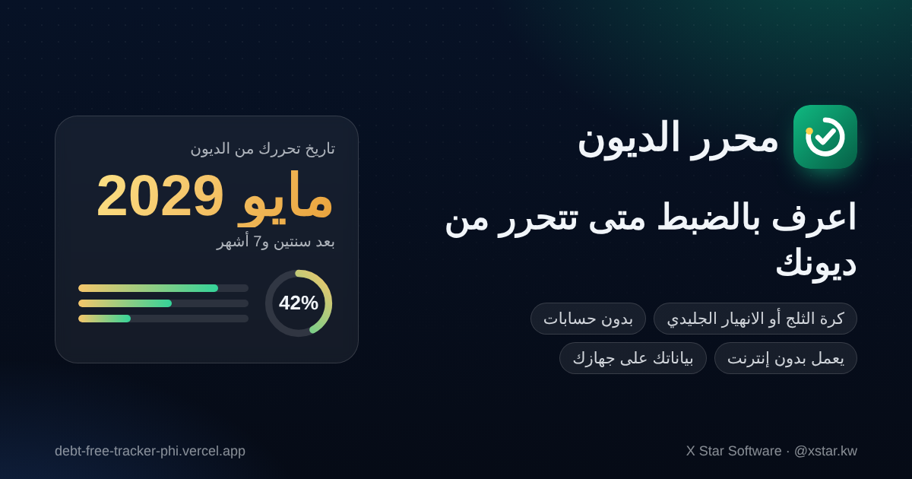

# محرر الديون — Debt Free



<div dir="rtl">

## نظرة عامة

**محرر الديون** يقول لك بالضبط في أي شهر تتحرر من ديونك. يقارن بين طريقتين للسداد: **كرة الثلج** (الأصغر رصيداً أولاً) و**الانهيار الجليدي** (الأعلى فائدة أولاً)، ويبيّن لك أي وحدة توفر أكثر، وكم تقرّب تاريخ تحررك أي دفعة إضافية.

بياناتك **ما تطلع من جهازك**. ما في حسابات ولا سيرفرات ولا تتبّع، والتطبيق يشتغل بدون إنترنت ويتثبت على الجوال مثل أي تطبيق.

## المميزات

- تاريخ التحرر من الديون، ونسبة المسدَّد، والدفعة الشهرية، والفوائد المتوقعة.
- مقارنة حيّة بين الطريقتين، مع جملة واضحة توضح كم توفر وزر لاعتماد الأفضل.
- شريط للدفعة الإضافية يحدّث الأرقام فوراً («توفّر 374 د.ك وتتحرر قبل 6 أشهر»).
- دفعة مقطوعة في شهر تختاره (مكافأة أو منحة أو بيع شي).
- القسط اللي يتحرر بعد سداد أي دين ينتقل تلقائياً للدين اللي بعده، فتبقى دفعتك الشهرية ثابتة.
- لكل دين: ترتيبه في الخطة، وتاريخ سداده المتوقع، وشريط تقدم، وسجل دفعات تقدر تتراجع عنها.
- رسم بياني تفاعلي (باللمس أو الماوس أو لوحة المفاتيح)، ومحطات التحرر، وجدول شهري مقسم حسب السنة.
- تنبيه واضح إذا الخطة ما تنتهي، مع زر يطبّق المبلغ اللي يخليها تنتهي.
- **وضع التمويل الإسلامي**: كلمة «ربح» بدل «فائدة»، مع إرشاد للمرابحة والتورق.
- **نسبة الأقساط من الراتب** مقارنة بالحد الشائع (40%).
- طباعة الخطة أو حفظها PDF، وتذكير شهري بالتقويم (.ics)، وبطاقة إنجاز للستوري **بدون أي مبالغ**.
- بيانات تجريبية بضغطة واحدة للعرض، وزر يرجعك لبياناتك.
- عربي (من اليمين لليسار) وإنجليزي (من اليسار لليمين)، ومظهر فاتح وداكن وتلقائي، والأرقام لاتينية في كل التطبيق.
- عملات الخليج (د.ك، ر.س، د.إ، ر.ق، د.ب، ر.ع) والدولار.
- نسخ احتياطي واستعادة بملف JSON، مع التحقق من الملف قبل الاستعادة، وتقدر تشفّر الملف بكلمة سر.
- **دفعات الشهر بضغطة**: تسجّل أقساط الشهر كلها مرة وحدة، مع سلسلة الالتزام، وهل أنت متقدم أو متأخر عن هدفك.
- **من بيانات العقد**: تدخل المبلغ الممول والنسبة (ثابتة أو متناقصة) والمدة والأقساط المدفوعة، ويطلع لك القسط والرصيد والنسبة الفعلية.
- **حاسبة شراء المديونية**: تقارن عرض البنك بأقساطك الحالية: القسط والمدة والتكلفة الكلية.
- **ترتيبي الخاص**: ترتّب الديون بنفسك (مثل سلفة الأهل أول)، ودفعة مقطوعة تتكرر كل سنة (البونص)، وكم تكلفك ديونك باليوم.
- **أدلة بالعربي** بأمثلة بالأرقام: كرة الثلج أو الانهيار، النسبة الثابتة والمتناقصة، شراء المديونية.

## التشغيل

ما في خطوة بناء ولا مكتبات خارجية. شغّل خادم ملفات محلي:

```bash
python3 -m http.server 8080
# ثم افتح http://localhost:8080
```

> افتحه عن طريق خادم، مو بالضغط على الملف مباشرة، لأن وحدات JavaScript ووضع العمل بدون إنترنت يحتاجون عنوان http.

**للعرض (الديمو):** افتح التطبيق، واضغط «جرّب ببيانات تجريبية»، وحرّك شريط الدفعة الإضافية، وبعدها اضغط «اعتمد الانهيار الجليدي». ولما تخلص اضغط «ابدأ ببياناتي».

</div>

---

## Overview

**Debt Free** tells you the exact month you will be free of debt. It compares the **Snowball** (smallest balance first) and **Avalanche** (highest rate first) strategies, shows which one saves more, and how much sooner any extra payment gets you there. Arabic-first (RTL) with full English, built for Kuwait and the GCC.

Planning tools (v2.1): a monthly check-in that logs every planned payment at once (with a streak and goal tracking), a contract helper that turns a flat-rate loan into its real rate, a debt buyout calculator, a custom payoff order, a yearly bonus, passphrase-encrypted backups, and short Arabic guides with worked examples.

Privacy is structural: no accounts, no servers, no analytics. Data lives in the browser (IndexedDB) and the Content-Security-Policy (`connect-src 'self'`, no third-party hosts at all) means the page *cannot* send it anywhere.

## Architecture

Static, zero-dependency PWA: no framework, no build step, no runtime third-party requests (fonts and icons are self-hosted). See [ADR 0001](docs/adr/0001-modular-static-pwa.md).

| Path | Role |
|---|---|
| `index.html` | Shell, CSP, SEO/OG meta |
| `assets/app.css` | Design system: tokens (light/dark), components, print, RTL via logical properties |
| `assets/js/engine.js` | Pure payoff engine (integer fils, rollover, lump sum, never-ending detection) |
| `assets/js/money.js` | Parse/format money (Arabic digits in, Latin digits out, 3-decimal KWD) |
| `assets/js/i18n.js` | Arabic/English copy, Arabic plural rules, interest/profit terminology |
| `assets/js/store.js` | IndexedDB, schema v1→v2 migration, backup validation |
| `assets/js/vault.js` | Passphrase-encrypted backups (PBKDF2-SHA-256 + AES-256-GCM), loaded on first use |
| `assets/js/app.js` | State, rendering, dialogs, interactions |
| `assets/js/chart.js` | Dependency-free SVG chart with crosshair tooltip and keyboard support |
| `assets/js/ui.js` / `share.js` / `icons.js` / `boot.js` | DOM helpers, story card + `.ics` (loaded on first use), Lucide icons, first-paint prefs |
| `guides/*.html` / `assets/guide.css` | Arabic guides (static articles, same CSP, precached for offline) |
| `sw.js` | Offline app shell; precache block generated by `tools/stamp-sw.mjs` |
| `vercel.json` / `.vercelignore` | Security headers + caching; only runtime files are deployed |

**Money** is stored and computed as integer fils (1 KWD = 1000 fils); interest is rounded to the fil each month, so a plan's totals always reconcile (`paid = start + interest`).

**Data migration:** records saved by v1 (float amounts) are converted to v2 on first load, and v1 backup files still import.

## Development

```bash
npm test              # unit tests: engine, money, i18n, storage (node:test, no deps)
npm run check         # syntax, references, zero third-party requests, CSP parity, SW stamp
npm run stamp         # re-stamp sw.js after changing any shipped file (CI fails if stale)
npm run smoke         # browser smoke + automated live checks (needs Playwright; axe optional)
npm run assets        # regenerate icons, favicon, OG image and install screenshots
```

`smoke` and `assets` use Playwright as a dev-only tool: `npm i -g playwright@1.56.1 axe-core@4.10.2`, then run with `PLAYWRIGHT_MODULE="$(npm root -g)/playwright" AXE_PATH="$(npm root -g)/axe-core/axe.min.js"`.

Enable the secrets hook once per clone: `git config core.hooksPath .githooks` (requires [gitleaks](https://github.com/gitleaks/gitleaks)).

## Quality

Latest evidence lives in [`checks/`](checks/README.md): 57 unit tests, a 44-step browser suite (accessibility scans of the app, its sheets and a guide, offline, update path, plain and encrypted backup round-trips, check-in, contract and buyout tools, XSS probe, CSP), Lighthouse **100** accessibility / best practices / SEO on every page tested, and clean gitleaks scans. Real-device checks (iPhone safe-area, install on iOS/Android, WhatsApp preview) are listed there as pending.

## Deploying

Vercel static hosting, no build command. Headers (CSP, HSTS, `nosniff`, `Referrer-Policy`, `Permissions-Policy`, font caching) come from `vercel.json`. Preview deployments show console CSP warnings for the Vercel toolbar script; production is unaffected.

## Credits

- IBM Plex Sans Arabic — SIL Open Font License 1.1 (`assets/fonts/OFL.txt`)
- Lucide icons — ISC License

Built by **X Star Software** — [@xstar.kw](https://www.instagram.com/xstar.kw)
